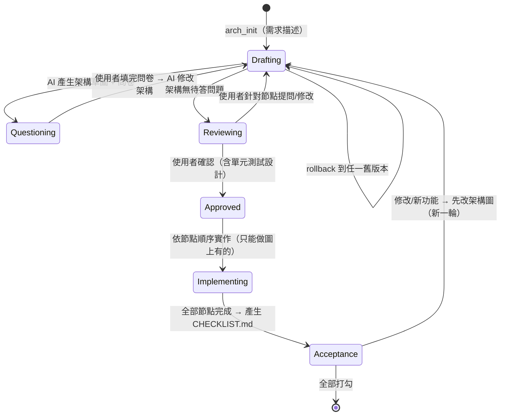

# ArchFlow MCP — 架構圖驅動的 AI 協作開發（HW2 規劃）

> 截止：11/1 23:59　｜　今天：10/23　｜　可用天數：約 9 天

## 1. 作業需求對照

| 作業要求 | 本專案如何滿足 | 狀態 |
|---|---|---|
| 任何值得做的專案 / 反覆出現的痛點 | 痛點：跟 AI 討論需求時雙方認知不一致、AI 自行腦補、改需求時沒有共同基準、無法退回舊設計 | ✅ 契合 |
| 報告：專案目的 | 上述痛點 + 「先對齊架構圖再實作」的流程 | ✅ |
| 報告：如何與 AI 協作 | 用 AI 開發本工具；再用本工具帶 AI 開發一個 demo 專案（dogfooding） | ✅ 需刻意記錄 |
| 報告：融入軟體工程實務（如單元測試） | 工具本身就內建「AI 先設計單元測試 → 使用者審 → 實作」；MCP server 自身也有 pytest + CI | ✅ 非常強的賣點 |
| GitHub git log | 每個功能一個 commit / PR；架構圖版本號寫進 commit message | 需執行 |
| AI collaboration log | 工具本身會產生 `history.jsonl`（每輪討論、問卷、修改），再加上 Claude Code 對話匯出 | ✅ 工具自帶 |
| Bonus：MCP server (+10%) | 整個專案就是 MCP server | ✅ 直接拿到 |
| 課堂展示加分 | 架構圖 + 問卷 + 打勾清單，視覺上很好 demo | 👍 |

**結論：符合，而且 bonus 天然就拿到。** 唯一要注意的是規模——9 天內要收斂成 MVP，進階功能列為 stretch。

## 2. 工作流程（狀態機）



規則（由 MCP 強制）：
- 未 `Approved` 前，`impl_*` 工具一律拒絕。
- 實作中想新增圖上沒有的東西 → 工具回傳錯誤，要求先走 change request。
- 每次架構變更都產生新版本 + 變更理由 + diff。

## 3. 資料存放（放在目標專案的 `.archflow/`）

```
.archflow/
  state.json            # 目前階段、目前版本、approved 版本
  versions/
    v001.json           # 節點、邊、決策、測試設計（完整快照）
    v002.json
  history.jsonl         # 每個事件：時間、類型、理由、diff 摘要（= 協作紀錄）
  questionnaire.md      # 目前待填問卷（使用者直接在檔案裡填）
  ARCHITECTURE.md       # 自動生成：Mermaid 圖 + 節點說明
  TEST_PLAN.md          # 自動生成：每個節點的單元測試設計
CHECKLIST.md            # 實作完成後生成，使用者打勾驗收
```

節點資料模型（草案）：
```json
{
  "id": "auth.login",
  "title": "登入 API",
  "type": "module|api|ui|data|external",
  "description": "...",
  "decisions": [{"question": "用 JWT 還是 session?", "answer": "JWT", "from": "Q3"}],
  "tests": [{"id": "T-auth-1", "desc": "密碼錯誤回 401", "status": "planned|written|passing"}],
  "impl": {"status": "todo|done", "files": ["src/auth.py"]},
  "notes": [{"by": "user", "text": "要支援 Google 登入嗎？"}]
}
```

## 4. MCP 工具清單

**討論 / 架構**
| 工具 | 功能 |
|---|---|
| `arch_init(name, requirements)` | 建立 `.archflow/`，記錄原始需求 |
| `arch_propose(nodes, edges, reason)` | AI 提交架構（新版本），自動生成 Mermaid |
| `arch_get(version?)` | 取得架構 JSON + Mermaid |
| `arch_update(patch, reason)` | 局部修改節點/邊 → 新版本 |
| `arch_diff(v_a, v_b)` | 兩版差異（新增/刪除/修改的節點） |
| `arch_history()` | 列出所有版本與理由 |
| `arch_rollback(version, reason)` | 以舊版內容建立新版本（不刪歷史），並回報對應 git commit |
| `node_comment(node_id, text)` | 記錄使用者對某節點的提問/修改要求 |

**問卷**
| 工具 | 功能 |
|---|---|
| `questions_create(questions[])` | 產生 `questionnaire.md`（單選/多選/自由填答，綁定節點） |
| `questions_collect()` | 解析使用者填好的答案 → 回傳給 AI 修改架構 |

**測試設計 / 實作**
| 工具 | 功能 |
|---|---|
| `tests_propose(node_id, cases[])` | AI 為節點設計單元測試 → 寫入 TEST_PLAN.md 供審閱 |
| `arch_approve()` | 鎖定版本；要求無未答問題、每個節點至少一個測試 |
| `impl_next()` | 依依賴順序回傳下一個要實作的節點與其規格、測試 |
| `impl_done(node_id, files[], tests_passing)` | 標記節點完成；拒絕不在架構中的節點 |
| `conformance_check()` | 檢查：所有節點都有實作/測試、沒有未登記的檔案 |

**驗收 / 迭代**
| 工具 | 功能 |
|---|---|
| `checklist_generate()` | 依節點與測試生成 `CHECKLIST.md`（- [ ] 可打勾，含測試步驟） |
| `checklist_status()` | 解析打勾狀況，回傳未勾項目 → AI 主動詢問使用者 |
| `change_request(description)` | 開新一輪：狀態回 Drafting，未勾項目自動帶入 |

另提供一個 MCP **prompt**（如 `archflow_workflow`）教 AI 整個流程，讓 Claude Code 一開始就知道要先畫圖、出問卷。

## 5. 技術選擇（建議）

- **語言**：Python + 官方 `mcp` SDK（FastMCP），寫起來最快；測試用 `pytest`。
- **圖**：存 JSON、輸出 Mermaid（Claude Code / VS Code / GitHub 都能直接渲染）。
- **問卷 UI**：MVP 用 markdown 檔填答；stretch 用 MCP elicitation 或本機 HTML 頁面。
- **版本**：自己的 JSON 快照（架構）+ git（程式碼），每個版本記錄當時的 git commit。
- **Client**：Claude Code（`claude mcp add archflow ...`）。

## 6. 時程（10/23 → 11/1）

| 日期 | 工作 | 產出 |
|---|---|---|
| 10/23–24 | 建 GitHub repo、專案骨架、資料模型、`arch_init/propose/get` + Mermaid | 第一批 commit + 測試 |
| 10/25 | 版本：`update/diff/history/rollback`、`node_comment` | 版本相關 pytest |
| 10/26 | 問卷：`questions_create/collect`（markdown 解析） | |
| 10/27 | 測試設計 + 核准閘門：`tests_propose`、`arch_approve`、`impl_next/done` | |
| 10/28 | 驗收：`checklist_generate/status`、`change_request`、`conformance_check` | MVP 完成 |
| 10/29 | Dogfooding：用 ArchFlow 帶 Claude 做一個小 demo（例：記帳 / Todo app），完整跑一輪 + 一次需求修改 + 一次 rollback | 協作紀錄、截圖 |
| 10/30 | GitHub Actions CI、README、修 bug | |
| 10/31 | 報告撰寫（目的、AI 協作、SE 實務、MCP） | 報告 |
| 11/1 | 緩衝 / 錄 demo | 繳交 |

**Stretch（有時間再做）**：elicitation 互動問卷、本機網頁顯示可點擊架構圖、節點 ↔ 程式碼自動追蹤。

## 7. 風險與誠實的限制

- **「嚴格按照架構圖實作」無法 100% 強制**：MCP 管不到 AI 直接寫檔。對策：工具閘門 + `conformance_check` + workflow prompt / CLAUDE.md 規則，報告中如實說明。
- **範圍過大**：上表 MVP 以外都列 stretch。
- **問卷體驗**：markdown 填答略陽春，但穩定、可 git 追蹤。

## 8. 待決定

1. 實作語言：Python（建議）或 TypeScript？
2. 問卷形式：markdown 檔（建議 MVP）／MCP elicitation／本機網頁？
3. Demo 專案要做什麼？
4. 主要搭配的 AI client：Claude Code？

## 9. 進度

- **10/23**：決定 Python + markdown 問卷 + Claude Code。完成 MVP：21 個 MCP 工具、網頁/App 節點類型、
  版本/rollback、問卷、測試閘門、實作追蹤、驗收清單、change request、協作紀錄匯出、HTML 架構圖檢視器。
  42 個 pytest 全過（Python 3.10 / 3.13），stdio MCP client 實測通過。
- 下一步：建 GitHub repo 並分批 commit → 在 Claude Code 接上 → 用 demo App 跑完整一輪（含一次修改、一次 rollback）→ 依實際使用體驗修正。
