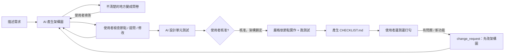

# ArchFlow MCP — 架構圖驅動的 AI 協作開發

跟 AI 做專案時最常見的問題：**AI 理解的需求和你想的不一樣**，沒講清楚的地方它自己腦補，
改需求時雙方沒有共同的基準，改壞了也很難退回。

ArchFlow 是一個 MCP server，讓 Claude Code 依照固定流程工作：



- **架構圖**：節點類型針對網頁 / App（頁面、元件、狀態、API、服務、資料、外部服務、背景工作、部署）。
  產生 `ARCHITECTURE.md`（Mermaid）與可點擊的 `architecture.html`。
- **問卷**：AI 不能自行猜測的決策會寫成 `questionnaire.md`，直接在檔案中打勾、填寫。
- **版本紀錄**：每次修改都是新版本並附上理由與 diff，可以 `arch_rollback` 退回任一版（歷史不會被刪除）。
- **測試先行**：每個節點都必須先設計測試，才能核准。
- **核准閘門**：未核准不能實作；實作中不能偷改架構；不在架構中的節點會被拒絕。
- **驗收清單**：`CHECKLIST.md` 讓你一邊測試一邊打勾；沒打勾的項目和問題回報會被帶入下一輪修改。
- **協作紀錄**：所有事件記錄在 `.archflow/history.jsonl`，`log_export` 可匯出成 `COLLABORATION_LOG.md`。

## 安裝（Windows）

需要 Python 3.10 以上與 Claude Code。

```powershell
cd C:\Users\1003e\Desktop\autonomous_architecture
python -m venv .venv
.venv\Scripts\pip install -e ".[dev]"
.venv\Scripts\pytest          # 跑單元測試
```

## 接到 Claude Code

在**要開發的專案資料夾**（例如你的 demo App）中執行：

```powershell
cd C:\path\to\my-app
claude mcp add archflow -- C:\Users\1003e\Desktop\autonomous_architecture\.venv\Scripts\archflow.exe
```

- 想在所有專案都能用：加上 `--scope user`。
- ArchFlow 會把資料寫在 Claude Code 啟動時所在的資料夾（`.archflow/`）。如果位置不對，可以指定：
  `claude mcp add archflow -e ARCHFLOW_PROJECT_DIR=C:\path\to\my-app -- ...archflow.exe`
- 確認：在 Claude Code 輸入 `/mcp`，應看到 `archflow` 與 21 個工具。

開始使用：直接描述你的想法，或用 prompt `/mcp__archflow__archflow_start`。
建議在專案的 `CLAUDE.md` 加一行：

```
本專案使用 ArchFlow MCP：先討論架構圖並取得我的核准才能寫程式；不確定該做什麼時呼叫 arch_status。
```

## 工具一覽

| 階段 | 工具 | 說明 |
|---|---|---|
| 全程 | `arch_status` | 目前階段與建議下一步 |
| 討論 | `arch_init` | 建立專案，回傳網頁/App 需確認的決策清單 |
| | `arch_propose` / `arch_update` | 提交完整架構 / 局部修改（都會產生新版本） |
| | `arch_get` / `node_detail` / `node_comment` | 查看架構、節點細節與討論 |
| | `arch_diff` / `arch_history` / `arch_rollback` | 版本比較、歷史、退回 |
| | `questions_create` / `questions_collect` | 產生問卷 / 讀取填答 |
| | `tests_design` | 為節點設計測試（寫入 TEST_PLAN.md） |
| 核准 | `arch_approve` | 需引用使用者原話；無待填問卷且每個節點都有測試 |
| 實作 | `impl_next` / `impl_done` | 依相依順序逐一實作並回報 |
| | `conformance_check` | 檢查是否全部完成、有沒有不屬於任何節點的程式碼 |
| 驗收 | `checklist_generate` / `checklist_status` | 產生 / 讀取驗收清單 |
| | `change_request` | 開啟新一輪修改（帶入未勾項目與問題） |
| | `log_export` | 匯出協作紀錄 |

## 產生的檔案

```
my-app/
  CHECKLIST.md               # 驗收清單（你打勾）
  COLLABORATION_LOG.md       # log_export 匯出
  .archflow/
    state.json               # 階段、版本、輪次
    versions/v0001.json ...  # 每個架構版本（含理由、git commit）
    architecture.html        # 用瀏覽器打開的架構圖
    ARCHITECTURE.md          # Mermaid 版架構圖
    TEST_PLAN.md             # 測試計畫
    questionnaire.md         # 目前的問卷（你填寫）
    questions/               # 歷次問卷與答案
    progress.json            # 各節點實作狀態
    comments.json            # 節點討論
    history.jsonl            # 完整事件紀錄
```

建議把 `.archflow/` 一起 commit，架構版本就能和程式碼版本對應。

## 限制

MCP 無法阻止 AI 直接寫檔案，所以「嚴格依架構實作」是靠：工具閘門（未核准不能回報實作、
未知節點會被拒絕）、`conformance_check` 找出沒對應到節點的程式碼，以及 server instructions
規範流程。

## 開發

```powershell
.venv\Scripts\pytest -q
```

程式結構：`models.py`（資料模型）、`project.py`（流程引擎）、`render.py`（Mermaid/HTML）、
`questionnaire.py`、`checklist.py`、`templates.py`（網頁/App 引導）、`server.py`（MCP 工具）。
